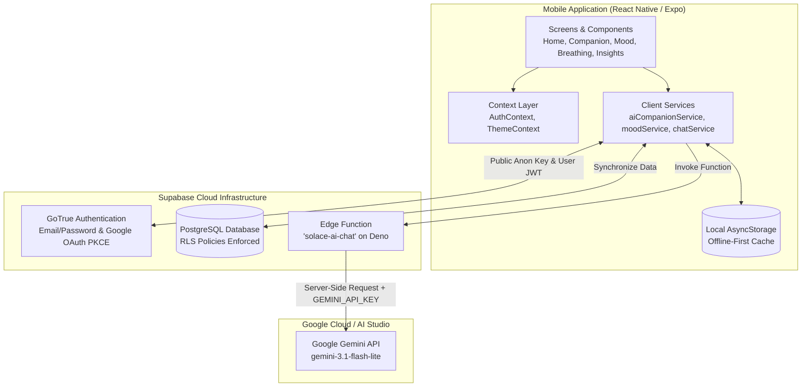

# Solace AI

> **A Restorative AI-Powered Mental Wellness Sanctuary & Mindful Companion**

Solace AI is a mobile mental wellness companion crafted to provide a calm, low-strain digital sanctuary for individuals navigating cognitive overload, stress, and emotional fatigue. Built with **React Native**, **Expo (SDK 58)**, **TypeScript**, **Supabase**, and powered by **Google Gemini**, Solace AI pairs mindful reflection, emotional check-ins, and somatic breathing exercises with an empathetic, data-grounded conversational AI companion.

---

## Table of Contents

- [About Solace AI](#about-solace-ai)
- [Key Features](#key-features)
- [Screenshots](#screenshots)
- [Technology Stack](#technology-stack)
- [Application Architecture](#application-architecture)
- [Project Folder Structure](#project-folder-structure)
- [Prerequisites](#prerequisites)
- [Installation and Setup Instructions](#installation-and-setup-instructions)
- [Environment Variable Configuration](#environment-variable-configuration)
- [Running the Application](#running-the-application)
- [Android Build Instructions](#android-build-instructions)
- [Supabase Backend Setup](#supabase-backend-setup)
- [AI Integration Architecture](#ai-integration-architecture)
- [Database and Security Information](#database-and-security-information)
- [Privacy and Responsible AI Disclaimer](#privacy-and-responsible-ai-disclaimer)
- [Troubleshooting](#troubleshooting)
- [Future Improvements](#future-improvements)
- [License](#license)

---

## About Solace AI

In an age of relentless digital noise, productivity pressures, and constant stimulation, our mental spaces frequently become cluttered and overwhelmed. Solace AI was designed from the ground up as an intentional digital retreat—reminiscent of a quiet, restorative sanctuary.

Unlike aggressive wellness apps that emphasize streaks, gamification points, and performative metrics, Solace AI emphasizes **restorative mindfulness, somatic calm, and gentle presence**. Its AI companion is not a therapist or clinical diagnostician; rather, it is a calm, compassionate sounding board that listens deeply, validates emotional reality without toxic positivity, and offers single, achievable micro-actions to restore equilibrium.

---

## Key Features

### 🌿 Solace AI Companion (Conversational Reflection)
- **Powered by Google Gemini**: Backed by `gemini-3.1-flash-lite` (with automatic failover to `gemini-3-flash-preview`) running within a secure Supabase Edge Function (`solace-ai-chat`).
- **Concise & Grounded**: Strict 80–140 word responses that directly acknowledge user-provided details without generic motivational clichés.
- **One Achievable Step & One Question**: Provides exactly one low-friction suggestion and one thoughtful follow-up question per reflection.
- **Multi-Turn Context Continuity**: Maintains conversational context across exchanges and hydrates full dialogue archives when reopening past sessions.
- **Built-in Crisis Detection**: Immediate keyword safety interceptor that surfaces emergency 24/7 crisis hotlines (988, 111, SHOUT, findahelpline) before invoking the AI.

### 🌸 Mindful Mood Check-in & Sentiment Tracking
- **Holistic Logging**: Track emotional valence, intensity sliders (1–10), and contextual tags (Work, Sleep, Relationships, Health, Creativity, Solitude).
- **Private Journaling**: Add optional qualitative reflections to capture context behind feelings.
- **Dual-Layer Persistence**: Offline-first storage via encrypted `AsyncStorage` with automatic bidirectional cloud synchronization to Supabase PostgreSQL.

### 🫁 Somatic Breathing Exercises
- **Guided Breath Pacing**: Interactive visual ring animations guiding restorative somatic breathing techniques.
- **Multiple Modalities**: 4-7-8 Relaxing Breath, Box (Square) Breathing, and custom calming rhythms.
- **Session Tracking**: Logs completion time, cycle counts, and mindful minutes to your personal wellness journey.

### 📊 Longitudinal Wellness Insights
- **Emotional Trends**: Visual distribution of logged emotions over rolling timeframes.
- **Gentle Analytics**: Highlighting calm moments, stress factors, and mindfulness habits without judgmental grading.
- **Mindful Streaks**: Gentle recognition of consistency that celebrates showing up without punitive resets.

### 🔐 Hybrid Authentication & Profile Sanctuary
- **Flexible Sign-in**: Email/password authentication alongside native Google OAuth via PKCE.
- **Dynamic Redirects**: Automatic environment detection between Expo Go development links (`exp://...`) and standalone Android production schemes (`solaceai://`).
- **Profile Customization**: Manage mindful reminder quiet hours, display preferences, and cloud sync settings.

---

## Screenshots

| 🌿 Companion Chat | 🌸 Mood Check-in | 🫁 Somatic Breathing |
| :---: | :---: | :---: |
| _[ Screenshot: AI Companion ]_<br>*(Warm reflections & prompt starters)* | _[ Screenshot: Mood Check-in ]_<br>*(Sentiment chips & intensity slider)* | _[ Screenshot: Breathing Pacer ]_<br>*(Animated breath rhythm ring)* |

| 🏡 Sanctuary Home | 📊 Wellness Insights | ⚙️ Sanctuary Profile |
| :---: | :---: | :---: |
| _[ Screenshot: Sanctuary Home ]_<br>*(Daily mindful quote & check-in card)* | _[ Screenshot: Wellness Insights ]_<br>*(Emotional patterns & activity charts)* | _[ Screenshot: Profile Settings ]_<br>*(Cloud sync & quiet hours)* |

---

## Technology Stack

| Layer | Technology | Details / Purpose |
|---|---|---|
| **Mobile Framework** | React Native 0.88.1 | Cross-platform native runtime |
| **Tooling & Platform** | Expo SDK ~58.0.23 | Managed workflow, Hermes engine, new architecture support |
| **Routing** | Expo Router ~58.0.30 | Type-safe, file-based routing (`solace-ai/src/app/`) |
| **Programming Language** | TypeScript ~6.0.3 | Strict static typing across all modules |
| **Typography** | Newsreader & Manrope | Editorial serif titles and modern sans-serif body |
| **Styling & Design Tokens** | Native StyleSheet | Custom design token system (radii, spacing, warm earth tones) |
| **Local Storage** | AsyncStorage 2.2.0 | Offline-first persistent key-value storage |
| **Backend & Database** | Supabase | PostgreSQL 15, Row Level Security (RLS), GoTrue Auth |
| **Cloud Functions** | Supabase Edge Functions | Deno runtime hosting the secure `solace-ai-chat` proxy |
| **AI Engine** | Google Gemini API | `gemini-3.1-flash-lite` via `v1beta` Generative Language API |
| **Notifications** | `expo-notifications` ~58.1.8 | Local scheduled mindfulness pauses and quiet hours |
| **In-App Browser & Auth** | `expo-web-browser` & `expo-linking` | PKCE OAuth authentication flow |
| **Build System** | EAS Build (Expo Application Services) | Android APK preview and release compilation |

---

## Application Architecture



---

## Project Folder Structure

```text
solace-ai/
├── assets/                         # Static assets (adaptive icons, splash screens)
│   └── images/                     # App icon, logo, illustrations
├── src/
│   ├── app/                        # Expo Router file-based screens
│   │   ├── (tabs)/                 # Bottom navigation tabs
│   │   │   ├── _layout.tsx         # Tab bar configuration & theme styling
│   │   │   ├── home.tsx            # Sanctuary dashboard & daily reflection
│   │   │   ├── companion.tsx       # AI companion dialogue interface
│   │   │   ├── insights.tsx        # Mood distribution & longitudinal trends
│   │   │   └── profile.tsx         # User profile, cloud status & settings link
│   │   ├── auth/
│   │   │   └── callback.tsx        # OAuth deep-link redirect receiver
│   │   ├── _layout.tsx             # Root stack navigator & font provider
│   │   ├── index.tsx               # Root entry point & auth gate
│   │   ├── onboarding.tsx          # 3-step introductory walkthrough
│   │   ├── login.tsx               # Email & Google Sign-in screen
│   │   ├── signup.tsx              # Account registration screen
│   │   ├── mood-check-in.tsx       # Interactive emotional logging modal
│   │   ├── breathing.tsx           # Somatic 4-7-8 & Box breathing pacer
│   │   ├── chat-history.tsx        # Saved companion reflection archive
│   │   ├── settings.tsx            # Notification preferences & privacy controls
│   │   ├── privacy.tsx             # Privacy policy & data ownership statement
│   │   └── terms.tsx               # Terms of service & wellness disclaimer
│   ├── components/                 # Reusable UI & atomic components
│   │   ├── solace/                 # SolaceButton, SolaceCard, SolaceHeader, etc.
│   │   └── ...                     # Modal pickers, chips, and animated icons
│   ├── constants/
│   │   └── theme.ts                # Authoritative design tokens (Colors, Typography, Radii)
│   ├── context/
│   │   ├── AuthContext.tsx         # Supabase session lifecycle & user state
│   │   └── ThemeContext.tsx        # Dynamic light/dark theme provider
│   ├── hooks/                      # Custom React hooks (useTheme, useColorScheme)
│   ├── services/                   # Business logic & cloud integration
│   │   ├── aiCompanionService.ts   # Edge function dispatcher & fallback handler
│   │   ├── authService.ts          # Sign-in, sign-up & PKCE Google OAuth
│   │   ├── breathingEngine.ts      # Somatic pacing timer math
│   │   ├── breathingService.ts     # Breathing session persistence
│   │   ├── chatService.ts          # Conversation dialogue store & cloud sync
│   │   ├── moodService.ts          # Mood logging, filtering & aggregation
│   │   ├── notificationService.ts  # Local mindfulness reminders & quiet hours
│   │   ├── supabaseClient.ts       # Supabase client singleton
│   │   └── supabaseSyncService.ts  # Bidirectional offline-to-cloud synchronization
│   └── types/                      # TypeScript definitions (chat, mood, breathing)
├── supabase/
│   ├── functions/
│   │   └── solace-ai-chat/         # Deno Edge Function contacting Gemini
│   │       └── index.ts            # System prompt, crisis filter, Gemini call
│   └── schema.sql                  # PostgreSQL database tables & RLS policies
├── app.json                        # Expo app manifest & configuration
├── eas.json                        # EAS Build profiles (APK preview & release)
├── package.json                    # Project dependencies & scripts
├── tsconfig.json                   # TypeScript compiler configuration
└── LICENSE                         # MIT open source license
```

---

## Prerequisites

Before setting up Solace AI locally, ensure you have the following installed on your machine:

1. **Node.js**: `v20.x` or `v22.x LTS` ([Download Node.js](https://nodejs.org/))
2. **Package Manager**: `npm` (bundled with Node) or `yarn`
3. **Expo Go Mobile App**: Installed on your physical Android device via Google Play Store (or an active Android emulator configured in Android Studio)
4. **Supabase Account**: A free Supabase project ([Sign up at supabase.com](https://supabase.com))
5. **Google AI Studio Key**: A free Gemini API key ([Get an API key](https://aistudio.google.com/))
6. **EAS CLI** *(optional, for standalone APK generation)*:
   ```bash
   npm install -g eas-cli
   ```

---

## Installation and Setup Instructions

### 1. Clone the Repository
```bash
git clone https://github.com/Coder-Jay00/solace-ai.git
cd solace-ai
```

### 2. Install Dependencies
```bash
npm install
```

### 3. Verify Expo Dependencies & TypeScript
Run Expo Doctor and TypeScript checks to confirm your environment is clean:
```bash
npx expo-doctor
node node_modules/typescript/bin/tsc --noEmit
```

---

## Environment Variable Configuration

Create a `.env` file in the root directory of `solace-ai`:

```bash
cp .env.example .env
```

Add your public Supabase project credentials:

```ini
# Supabase Public API Configuration
EXPO_PUBLIC_SUPABASE_URL=https://your-project-id.supabase.co
EXPO_PUBLIC_SUPABASE_ANON_KEY=your-supabase-publishable-or-anon-key
```

> [!CAUTION]
> **Security Notice**:
> - Never commit your `.env` file to version control. It is strictly included in `.gitignore`.
> - Only public/publishable keys (`EXPO_PUBLIC_*`) may reside in this file.
> - **Never** place the Supabase `service_role` secret or your `GEMINI_API_KEY` inside `.env`. Those secrets belong exclusively inside your Supabase Edge Function environment.

---

## Running the Application

### Start the Metro Development Server
```bash
npx expo start
```

### Launch Options
- **On Physical Android Device (Recommended)**: Open the Expo Go app on your phone, tap **Scan QR code**, and scan the QR code displayed in your terminal.
- **On Android Emulator**: Press `a` in the terminal (ensure your Android emulator is booted in Android Studio).
- **On Web Preview**: Press `w` in the terminal to launch the web preview.

---

## Android Build Instructions

Solace AI is configured with [EAS Build](https://docs.expo.dev/build/introduction/) to compile standalone, installable Android APKs directly in the cloud.

### Build Configuration (`eas.json`)
The `preview` profile is configured with `buildType: "apk"` and internal distribution:

```json
{
  "cli": { "version": ">= 18.0.0" },
  "build": {
    "preview": {
      "distribution": "internal",
      "android": {
        "buildType": "apk"
      },
      "env": {
        "EXPO_PUBLIC_SUPABASE_URL": "https://your-project-id.supabase.co",
        "EXPO_PUBLIC_SUPABASE_ANON_KEY": "your-supabase-anon-key"
      }
    }
  }
}
```

### Command to Generate the Standalone APK

Log into your Expo account and trigger the cloud build:

```bash
npx eas login
npx eas build --platform android --profile preview
```

> [!TIP]
> **Why Cloud Build?**
> EAS Cloud Build executes on managed Linux runners, completely avoiding Windows-specific CMake / Ninja C++ directory path issues when compiling native modules like `react-native-worklets`. Once the build finishes, EAS provides a direct download link and QR code to install the APK directly onto your Android device.

---

## Supabase Backend Setup

### 1. Database Schema
Execute [`supabase/schema.sql`](supabase/schema.sql) inside your Supabase SQL Editor. This script creates:
- `public.profiles`: User profile data (name, avatar, notification preferences).
- `public.conversations`: Chat sessions and latest exchange timestamps.
- `public.chat_messages`: Individual dialogue messages with `is_crisis` flags.
- `public.mood_check_ins`: Mood scores, emotion tags, notes, and timestamps.
- `public.breathing_sessions`: Completed somatic breathing records and durations.

### 2. Enable Google OAuth (Optional but Recommended)
1. In Google Cloud Console, create an **OAuth 2.0 Web Client ID**.
2. Add your Supabase Auth callback URL:
   `https://<your-project-id>.supabase.co/auth/v1/callback`
3. In Supabase Dashboard, navigate to **Authentication** → **Providers** → **Google**:
   - Enable the Google provider.
   - Enter your Google Client ID and Client Secret.
4. In Supabase Dashboard, navigate to **Authentication** → **URL Configuration**:
   - Set Redirect URLs to include:
     - `solaceai://auth/callback` (for standalone APK)
     - `exp://<your-local-ip>:8081/--/auth/callback` (for Expo Go testing)

### 3. Deploy the Edge Function (`solace-ai-chat`)
1. Link your Supabase project:
   ```bash
   npx supabase link --project-ref your-project-id
   ```
2. Store your Google Gemini API key as a secure secret:
   ```bash
   npx supabase secrets set GEMINI_API_KEY=your-gemini-api-key
   ```
3. Deploy the Edge Function:
   ```bash
   npx supabase functions deploy solace-ai-chat --yes
   ```

---

## AI Integration Architecture

Solace AI connects to the Google Gemini API through an architectural proxy pattern to maximize security, safety, and response quality:

```
[Mobile Client] 
     │  (1) Calls aiCompanionService.generateReply(messageText)
     ▼
[Supabase Edge Function: solace-ai-chat]
     │  (2) Evaluates caller JWT or Project API Key
     │  (3) Pre-screening: Checks for emergency crisis patterns
     │  (4) Sanitizes dialogue history into alternating turns
     │  (5) Injects Solace Sanctuary System Prompt
     ▼
[Google Gemini API (v1beta)]
     │  (6) Invokes gemini-3.1-flash-lite (350 max tokens)
     │  (7) Fallback to gemini-3-flash-preview on rate limits
     ▼
[Edge Function Response]
     │  (8) Persists exchange into public.chat_messages
     │  (9) Returns sanitized reflection to client
```

### Conversational Guidelines Enforced by System Instruction
1. **Warm & Empathetic Presence**: Validates user emotions with calm groundedness; strictly avoids toxic positivity.
2. **Concise Length**: Strictly formatted to 80–140 words.
3. **Contextually Grounded**: Directly references details mentioned by the user; avoids hallucinating unstated background stories.
4. **No Motivational Clichés**: Banned phrases include *"Take a deep breath and remember you've got this"*, *"Every cloud has a silver lining"*, and *"You are doing amazing"*.
5. **Single Actionable Suggestion**: Offers exactly one low-effort, practical micro-step (e.g., sipping water, stepping outside for 2 minutes).
6. **Single Open-Ended Question**: Concludes with one caring, open-ended question that encourages gentle self-exploration.

---

## Database and Security Information

- **Row Level Security (RLS)**: Every table in `supabase/schema.sql` has RLS enabled. Users can only query and mutate rows where `auth.uid() = user_id`.
- **Zero Secrets on Client**: The mobile client only possesses public, publishable identifiers (`EXPO_PUBLIC_SUPABASE_URL` and `EXPO_PUBLIC_SUPABASE_ANON_KEY`).
- **Encrypted Local Storage**: Local cached dialogues and moods are partitioned strictly by `userId` to prevent data leakage between different accounts on shared devices.
- **Server-Side API Key Storage**: The `GEMINI_API_KEY` is stored strictly within Supabase Vault Secrets and is never bundled in the app binary or transmitted to the mobile client.

---

## Privacy and Responsible AI Disclaimer

> [!IMPORTANT]
> **Solace AI is a supportive mindfulness journaling and reflection tool—not a medical clinic, crisis intervention service, or licensed psychiatric therapy provider.**
>
> Solace AI does not provide medical diagnoses, psychological treatment, or crisis intervention. If you or someone you know is in crisis or experiencing thoughts of self-harm, immediate professional human support is available:
>
> - **United States & Canada**: Call or text **988** (Suicide & Crisis Lifeline, Free, Confidential, 24/7)
> - **United Kingdom**: Call **111** (NHS) or text **SHOUT** to **85258**
> - **International**: Find confidential local crisis lines worldwide at [findahelpline.com](https://findahelpline.com/)
> - **Immediate Danger**: Please contact your local emergency services (911, 999, 112) or go to the nearest emergency center.

---

## Troubleshooting

### 1. Google OAuth stuck or redirects to `http://localhost:3000`
- **Cause**: Supabase Authentication → URL Configuration redirect allowlist does not contain the dynamic Expo Go development URI.
- **Fix**: In your Supabase Dashboard under **Authentication** → **URL Configuration**, add:
  `exp://<your-machine-ip>:8081/--/auth/callback` and `solaceai://auth/callback`.

### 2. "I'm temporarily unable to connect to Solace AI" in chat
- **Cause**: The `solace-ai-chat` Edge Function is unreachable or the `GEMINI_API_KEY` secret is not set in Supabase.
- **Fix**: Run `npx supabase secrets set GEMINI_API_KEY=your-key` and redeploy the function via `npx supabase functions deploy solace-ai-chat --yes`. Tap the in-chat `↻ Tap to Retry Reflection` button once deployed.

### 3. Local Windows Gradle build fails with `ninja: error: mkdir ... No such file or directory`
- **Cause**: The project root directory contains spaces (e.g. `New Project`), which breaks CMake/Ninja path generation on Windows for native C++ modules.
- **Fix**: Use EAS Cloud Build (`npx eas build --platform android --profile preview`), or map the workspace to a drive letter without spaces using `subst X: "path\to\solace-ai"` and build from `X:\`.

### 4. Metro Bundler cache issues
- **Fix**: Clear Metro cache and restart the development server:
  ```bash
  npx expo start -c
  ```

---

## Future Improvements

- [ ] **Wearable Integration**: Synchronize heart rate variability (HRV) metrics to trigger somatic breathing suggestions during elevated stress.
- [ ] **Guided Audio Soundscapes**: Gentle binaural beats and ambient nature soundscapes during breathing exercises.
- [ ] **End-to-End Client Encryption**: Zero-knowledge encryption for personal qualitative journal entries before cloud sync.
- [ ] **Cross-Platform Desktop Client**: Seamless tablet and desktop experience via React Native for Web and Electron.

---

## License

This project is licensed under the **MIT License** — see the [LICENSE](solace-ai/LICENSE) file for details.

---

<p align="center">
  Crafted with care by <a href="https://github.com/Coder-Jay00">Coder-Jay00</a> 🌿
</p>

